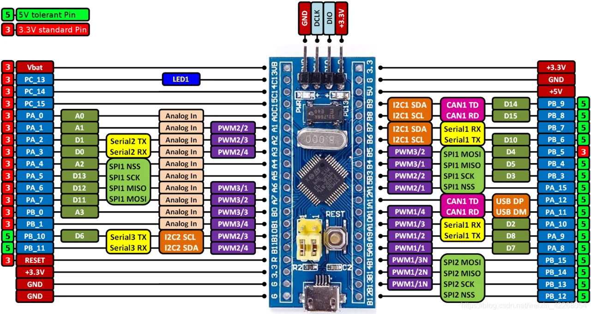

# STM32 Bare-Metal Learning

> A hands-on journey through embedded C programming — from basic language concepts on the host machine to real bare-metal register-level programming on the **STM32F103C8T6 (Blue Pill)**.



---

## 📊 Repo Stats

<table width="100%">
  <tr>
    <td align="center" width="25%">
      
    </td>
    <td align="center" width="25%">
      
    </td>
    <td align="center" width="25%">
      
    </td>
    <td align="center" width="25%">
      
    </td>
  </tr>
</table>

---

## 📋 About This Repository

This repository is a structured learning journal for **bare-metal embedded C** on STM32 microcontrollers.  
It is split into two clear sections:

| Folder | Purpose |
|--------|---------|
| [`host/`](./host/) | Standard C exercises compiled and run on a PC (GCC) |
| [`target/`](./target/) | Bare-metal C projects flashed and run on the STM32F103C8T6 |

The `host/` projects build core C language skills — pointers, structs, unions, bitwise operations, etc.  
The `target/` projects apply those skills directly at the register level on real hardware, with **no HAL or CMSIS** — just raw memory-mapped peripheral access.

---

## 🛠️ Hardware

| Item | Details |
|------|---------|
| **MCU** | STM32F103C8T6 (ARM Cortex-M3, 72 MHz) |
| **Board** | Blue Pill |
| **Flash** | 64 KB |
| **RAM** | 20 KB |
| **Debug** | ST-Link V2 (SWD), ARM Semihosting |
| **IDE** | STM32CubeIDE |

Reference documents are included in the root:
- [`stm32f103c8 (1).pdf`](./stm32f103c8%20(1).pdf) — Datasheet
- [`reference_manual_stm.pdf`](./reference_manual_stm.pdf) — Reference Manual (RM0008)
- [`original-schematic-STM32F103C8T6-Blue_Pill.pdf`](./original-schematic-STM32F103C8T6-Blue_Pill.pdf) — Board Schematic

---

## 📂 Repository Structure

```
STM32/
├── host/                    # C language exercises (runs on PC)
│   ├── pointer/
│   ├── struct/
│   ├── union/
│   ├── bitwise_operator/
│   └── ...                  # 78 projects total
│
├── target/                  # STM32 bare-metal projects
│   ├── helloworld_semihosting/
│   ├── sizeof/
│   ├── 007volatile/
│   ├── PR/
│   ├── led_on/
│   ├── struct_based_led/
│   ├── pin_read/
│   └── KEYPAD/
│
├── stm32-board.png
├── reference_manual_stm.pdf
├── stm32f103c8 (1).pdf
└── original-schematic-STM32F103C8T6-Blue_Pill.pdf
```

---

## 🎯 Target Projects (STM32 Bare-Metal)

All target projects run directly on the **STM32F103C8T6 (Blue Pill)** with **no HAL, no CMSIS, no drivers** — purely memory-mapped register manipulation.

| # | Project | Concept | Key Registers | Description |
|---|---------|---------|---------------|-------------|
| 1 | [`helloworld_semihosting`](./target/helloworld_semihosting/) | Semihosting | — | First program: `printf("Hello World")` over SWD via ARM semihosting |
| 2 | [`sizeof`](./target/sizeof/) | Data Types / Architecture | — | Prints byte sizes of C data types on the ARM Cortex-M3 target |
| 3 | [`007volatile`](./target/007volatile/) | `volatile` Keyword | — | Demonstrates why `volatile` prevents compiler optimization of hardware registers |
| 4 | [`PR`](./target/PR/) | GPIO Output / Register Basics | `RCC_APB2ENR`, `GPIOC_CRH`, `GPIOC_ODR` | First LED blink (PC13) — direct register manipulation using raw hex values |
| 5 | [`led_on`](./target/led_on/) | GPIO Output / Bit Manipulation | `RCC_APB2ENR`, `GPIOC_CRH`, `GPIOC_ODR` | LED blink refactored using clean bit-shift expressions instead of raw hex |
| 6 | [`struct_based_led`](./target/struct_based_led/) | Structs / Register Abstraction | `RCC_APB2ENR`, `GPIOC_CRH`, `GPIOC_ODR` | LED blink using C structs mapped to peripheral registers — foundational HAL/CMSIS pattern |
| 7 | [`pin_read`](./target/pin_read/) | GPIO Input + Output | `GPIOA_CRL`, `GPIOA_IDR`, `GPIOA_ODR`, `GPIOC_CRH`, `GPIOC_ODR` | Reads digital input on PA0 (button with internal pull-down) to drive PC13 LED |
| 8 | [`KEYPAD`](./target/KEYPAD/) | GPIO Multiplexing / Matrix Scanning | `GPIOA_CRH`, `GPIOB_CRH`, `GPIOA_IDR`, `GPIOB_ODR` | 4×4 matrix keypad scanner using row-drive / column-read multiplexing with semihosting output |

> 📖 Each project contains its own self-contained source, debug configs, and dedicated [`README.md`](./target/README.md) with circuit schematics and register breakdowns.

---

## ⚙️ How to Build & Flash

### Prerequisites
- [STM32CubeIDE](https://www.st.com/en/development-tools/stm32cubeide.html)
- ST-Link V2 programmer

### Steps
1. Open STM32CubeIDE
2. **File → Open Projects from File System** → select the desired `target/` subfolder
3. Build: `Project → Build Project` (or `Ctrl+B`)
4. Flash: `Run → Debug` with ST-Link connected via SWD

### Semihosting Output (printf)
Projects like `helloworld_semihosting`, `sizeof`, and `KEYPAD` use **ARM Semihosting** to print to the IDE console.  
Make sure the debug configuration has semihosting enabled.

### Host Projects
Host projects are standalone `.c` files. Compile with GCC:
```bash
gcc project.c -o project && ./project
```

---

## 📚 Topics Covered

### C Language Fundamentals (`host/`)
- Data types, type qualifiers, `sizeof`, `typedef`
- Arrays, 2D/3D multi-dimensional arrays, strings, string literals
- Pointers, pointer arithmetic, struct pointers, null/void pointers
- Arrays and pointers relationship; pointer decay; passing arrays to functions
- Call-by-reference via pointers; in-place variable modification
- Structs, unions, bitfields, packet structures
- Control flow: `if`, `switch`, loops (`for`, `while`, `do-while`)
- Operators: arithmetic, bitwise, shift
- Functions, function pointers, callbacks, command-line arguments (`argc`, `argv`), macros, ASCII
- Dynamic memory allocation (`malloc`, `calloc`, `realloc`, `free`), memory leaks, stack vs heap
- Register bitwise operations: setting, clearing, toggling, testing bits, bitfield manipulation, MSB isolation, bit spreading/interleaving, register packing macros, and status register flag decoding
- C & firmware pitfalls: bitwise operator precedence, integer promotion with bitwise NOT, and macro multiple-evaluation side effects
- Bitwise algorithms: in-place XOR variable swap
- Array algorithms & patterns: even/odd index parity sums, prefix/cumulative sum, conditional element transformation, triplet sum search (target 3-sum), second distinct maximum with duplicate handling, auxiliary and two-pointer in-place reversal, and $k$-step array rotation via reversal algorithm
- Build process understanding

### STM32 Bare-Metal (`target/`)
- Semihosting and `printf` over SWD
- `sizeof` on ARM Cortex-M types
- `volatile` keyword in embedded context
- GPIO configuration via raw register access (RCC, CRH, CRL, ODR, IDR)
- LED blink (pointer-based and struct-based)
- Digital input reading (button → LED)
- 4×4 Matrix Keypad scanning via row/column multiplexing

---

## 📈 Commit Activity

<p align="center">
  <a href="https://github.com/joeljo777/stm32-bare-metal/commits/main">
    
  </a>
</p>

---

## 📄 License

This project is for educational purposes. All STM32 peripheral code follows patterns from the official [STM32F103 Reference Manual (RM0008)](./reference_manual_stm.pdf).
